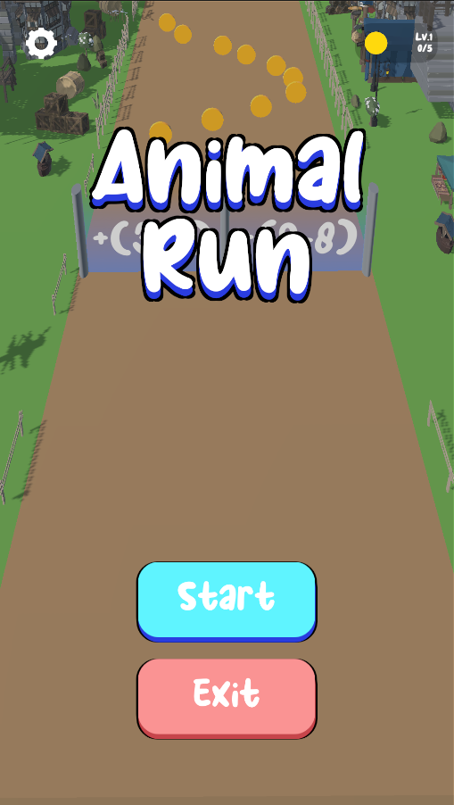
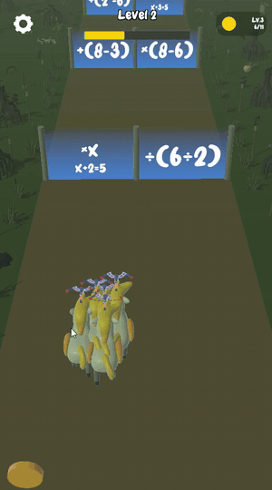

# 애니멀 런

> 수식 문을 골라 동물 무리를 늘리고, 무기로 적을 쓰러뜨리며 결승선까지 달리는 3D 크라우드 러너



> **코드 공개용 저장소입니다.** 유료 에셋과 씬·프리팹을 빼고 직접 작성한 C# 코드만 원본 저장소에서 옮겼습니다.
> Unity에서 열어도 실행되지 않으니, 플레이 모습은 아래 시연 영상으로 봐 주세요.

## 링크

- [시연 영상](https://youtu.be/vwFRyeQ6Njk) · [쇼츠](https://youtube.com/shorts/lrA1PyblqnI)
- [프로젝트 상세 문서](https://tmdrn17.github.io/portfolio/doc.html?p=05-AnimalRun) — 설계 이유 · 문제 해결 · 회고
- [슬라이드](https://tmdrn17.github.io/portfolio/project.html?p=05-AnimalRun)
- [포트폴리오](https://tmdrn17.github.io/portfolio/)

## 개요

| 항목 | 내용 |
|---|---|
| 장르 | 3D 크라우드 러너 (모바일 세로 화면) |
| 기간 | 2023.10 원형 제작 → 2026.09 리팩토링 |
| 인원 | 개인 프로젝트 |
| 환경 | Unity 2023.1, C#, CsvHelper (TSV 데이터), Blender(Claude) |
| 내 역할 | 기획·개발 전체 |

## 핵심 기능

| 기능 | 설명 | 코드 |
|---|---|---|
| 목표 플레이 시간에 맞춘 레벨 생성 | 플레이 시간 × 기준 속도로 목표 거리를 먼저 정해, 판마다 플레이 시간이 고르게 됩니다. | [ChunkManager.cs](Scripts/Managers/ChunkManager.cs) |
| 정답을 먼저 정하고 식을 만드는 수식 문 | 결과값을 먼저 뽑고, 그 값이 나오도록 식을 거꾸로 만듭니다. | [DoorQuiz.cs](Scripts/Stage/DoorQuiz.cs) |
| 콜라이더 없이 거리로 처리하는 적 판정 | 적과 러너의 접촉 및 총알 명중을 물리 콜라이더 이벤트가 아닌 거리·이동 선분 기반으로 판정합니다. | [Enemy.cs](Scripts/Enemy/Enemy.cs) · [Bullet.cs](Scripts/Weapon/Bullet.cs) |
| 게임 시작 시 동물 · 무기 선택 | 게임을 시작할 때 동물 3개와 무기 3개를 선택지로 줍니다. 고른 동물과 무기로 한 판을 진행합니다. | [SelectManager.cs](Scripts/Managers/SelectManager.cs) |



## AI 협업

`AI-Assisted/`에는 AI(Claude)가 작성한 코드를 내가 짠 코드와 나눠 두었습니다.

- [Editor/ChunkThemeBuilder.cs](AI-Assisted/Editor/ChunkThemeBuilder.cs)
- [Editor/EnemyThemeBuilder.cs](AI-Assisted/Editor/EnemyThemeBuilder.cs)
- [Editor/RunnerPrefabBuilder.cs](AI-Assisted/Editor/RunnerPrefabBuilder.cs)
- [Editor/RunnerPrefabRequestWatcher.cs](AI-Assisted/Editor/RunnerPrefabRequestWatcher.cs)
- [Editor/SelectCardBuilder.cs](AI-Assisted/Editor/SelectCardBuilder.cs)

프로젝트 문서의 AI 활용: 레벨 생성 일부 수정, 동물 에셋 제작 파이프라인, 맵 테마(청크 · 적 · 테마 구조) 제작에 Claude 사용.

에디터 툴(동물 프리팹 · 테마 청크 · 테마 적 · 선택 카드)은 모두 AI가 작성해 `AI-Assisted/Editor/`에 따로 두었습니다.

## 강사 제공 코드

`Course-Provided/`에는 수업에서 강사님이 제공한 유틸 중, 이 저장소의 내 코드가 쓰는 파일만 따로 두었습니다. 직접 작성한 코드가 아닙니다.

- [SingletonBase.cs](Course-Provided/SingletonBase.cs)

## 폴더 구조

```
AI-Assisted/
└── Editor/  (5)
Course-Provided/
└── SingletonBase.cs
Data/
├── Animals.tsv
├── Augments.tsv
└── Weapons.tsv
Scripts/
├── CameraFollow.cs
├── Data/  (8)
├── DescendingLightColumnController.cs
├── DissolveController.cs
├── Enemy/  (3)
├── Managers/  (9)
├── Player/  (7)
├── Stage/  (6)
├── UI/  (2)
└── Weapon/  (4)
images/
```

괄호 안은 파일 수입니다. `Data/`는 게임이 읽는 TSV 데이터 표입니다.

## 사용 라이브러리 · 에셋

저장소에 넣지 않았습니다.

- CsvHelper (TSV 데이터 읽기)
- Synty 에셋(캐릭터 · 맵)
- Cartoon FX (이펙트)
